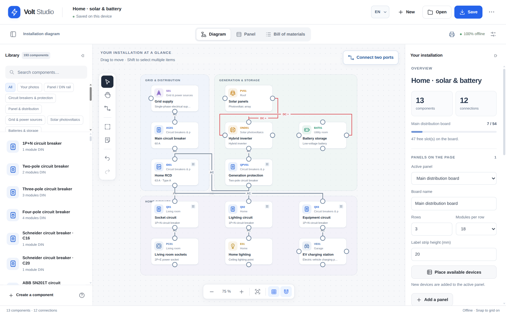
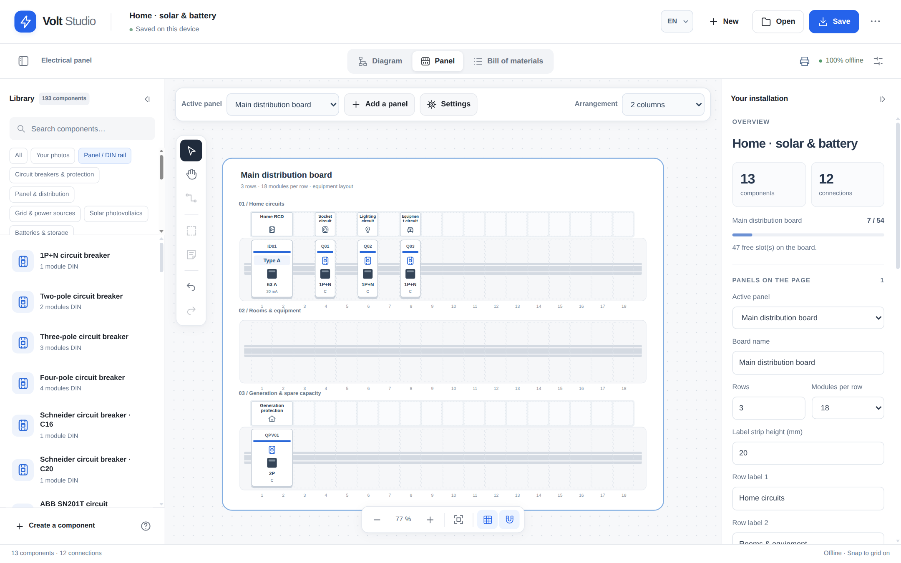
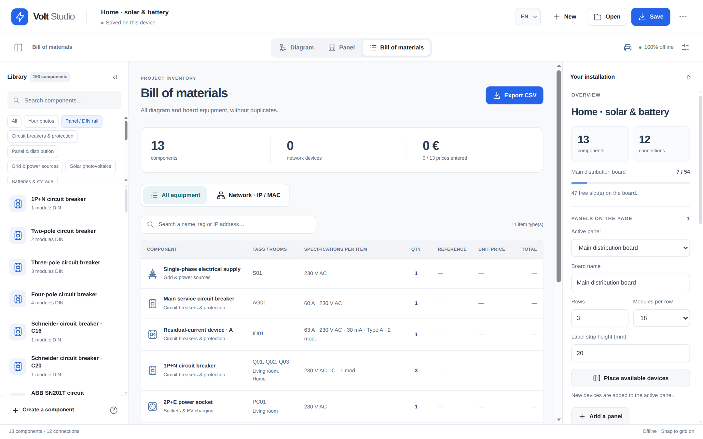
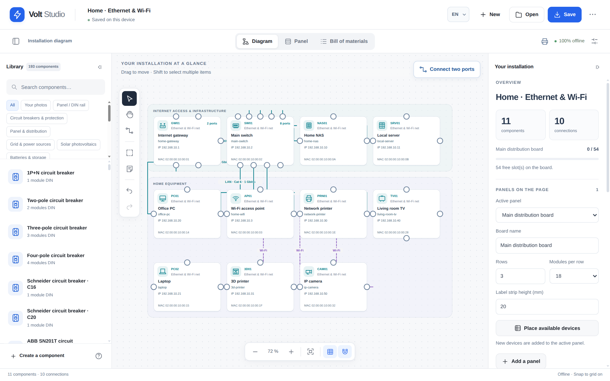

# Volt Studio

**Volt Studio** is a standalone, 100% offline, single-file HTML web application for designing electrical installation diagrams, DIN-rail distribution panels, solar & battery systems, low-voltage / Ethernet & Wi-Fi networks, and bills of materials.

No installation, no server, no external dependencies — just open [`volt-studio.html`](volt-studio.html) in any modern browser.



---

## Features

- **Single-File & 100% Offline** — The entire application lives in `volt-studio.html` with a strict Content Security Policy (`connect-src 'none'`), local auto-save in your browser, and zero network requests.
- **Three Synchronized Views**
  - **Diagram** — Interactive SVG canvas with drag-and-drop placement, color-coded zones, notes, customizable wire routing (AC, DC, Earth, Signal, Audio, Ethernet, Wi-Fi, Fiber), snap-to-grid, alignment/distribution tools, and full undo/redo.
  - **Electrical Panel (DIN Rail)** — Visual distribution board layout with multiple panels per project, configurable rows and modules per row, automatic DIN-rail placement, circuit labels, usage icons, and adjustable label strip height.
  - **Bill of Materials & Network Inventory** — Deduplicated equipment summary with quantities, references, unit pricing and total cost estimation, search filtering, and a dedicated **Network · IP / MAC** inventory tab.
- **193 Built-in Components + Custom Components** — Organized across 13 categories:
  - Circuit breakers & protection
  - Panel & distribution
  - Grid & power sources
  - Solar photovoltaics
  - Batteries & storage
  - Sockets & EV charging
  - Lighting & switches
  - Home & appliances
  - Heating, ventilation & water
  - Control & automation
  - Metering & monitoring
  - Connections & low-current systems
  - Ethernet & Wi-Fi network
  - Plus **custom component creation**, **favorites**, and **custom photos**.
- **Starter Templates** — Start from a **Blank project**, **Home & solar**, **Home**, **Electrical panel**, or **Home & network** template.
- **Import, Export & Print**
  - Save and reopen projects in **JSON** format.
  - Export a portable **Application + Project** bundle into a single standalone **HTML** file.
  - Export diagrams to **SVG** or **PNG**.
  - Export the **Bill of Materials** or **Network Inventory** to **CSV**.
  - Built-in **A4 Print** layout.
- **Bilingual Interface (EN / FR)** — Switch between English (`EN`) and French (`FR`) at any time from the top bar.

---

## Screenshots

### Electrical Panel (DIN Rail)

Manage one or more distribution boards with automatic module mounting, row labels, and customizable strip heights.



### Bill of Materials

Review all diagram and board equipment without duplicates, track references and pricing, and export to CSV.



### Low-Voltage & Network Topology

Document gateways, switches, NAS devices, access points, IP/MAC addresses, and Ethernet, Wi-Fi, or fiber links.



---

## Getting Started

1. Download [`volt-studio.html`](volt-studio.html) or clone this repository:
   ```bash
   git clone https://github.com/omnia-projetcs/volt-studio.git
   ```
2. Open `volt-studio.html` directly in your browser (Chrome, Firefox, Edge, Safari).
3. Use the language selector in the top-right corner (`EN` / `FR`) if you want to switch the interface language.
4. Click **New** to pick a starter template or start from a blank canvas.

---

## Keyboard Shortcuts

| Shortcut | Action |
| --- | --- |
| `V` | Select tool |
| `H` / `Space` | Pan view |
| `C` | Connect / wire tool |
| `N` | Add note |
| `Z` | Add zone |
| `Mouse wheel` | Zoom around pointer |
| `0` | Fit diagram to view |
| `Shift + Drag` | Box selection |
| `Arrow keys` | Nudge selection |
| `Esc` | Cancel wire / deselect |
| `Ctrl / ⌘ + S` | Save project (JSON) |
| `Ctrl / ⌘ + O` | Open project (JSON) |
| `Ctrl / ⌘ + Z` | Undo |
| `Ctrl / ⌘ + Shift + Z` | Redo |
| `Ctrl / ⌘ + D` | Duplicate selection |
| `Ctrl / ⌘ + C` / `V` | Copy / paste |
| `Ctrl / ⌘ + A` | Select all |
| `Delete` | Delete selection |

---

## Scope & Disclaimer

Volt Studio is a **drawing, organization, and inventory tool**. The built-in library is generic and extensible rather than an exhaustive manufacturer catalog. It does **not** perform cable sizing, protection coordination, or electrical code compliance checks. Always verify electrical installations against applicable local standards and qualified professional guidance.

---

## License

This project is licensed under the [MIT License](LICENSE).
